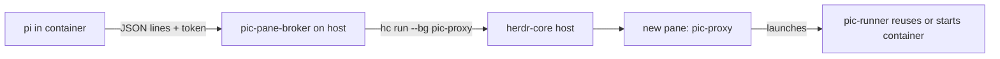

# hc integration: open a `pic-proxy` pane from inside the container

Status: design agreed, not implemented.
Goal: a containerized Pi session can ask the host to open a new Herdr pane
running `pic-proxy` on the same project, so delegation keeps the same
container structure. The container must not gain general host control.

## Why not hc-in-the-container

herdr-core has no per-client auth: anyone holding the core socket gets full
exec, file, and terminal APIs on the host. The core socket is a host unix
socket (`~/.local/state/herdr-core/<session>/default.sock`) that an Apple
container VM cannot reach, and a byte bridge (`socat` + `hc connect`, the
`ssh box hc connect` pattern) would hand the container that whole API. A
prompt-injected agent inside the container would then own the host. So: no
`hc` binary and no raw protocol in the image. Trust stays in host code.

## Decision

Give the container a capability, not an API. A host-side broker speaks one
fixed protocol and calls `hc` itself. The only thing a container can do is
open and tend `pic-proxy` panes it created, for the one workdir it was
launched with.

## Components

| Piece | Where | Role |
|---|---|---|
| `pane-broker.cjs` | host, spawned by `pic-runner` per launch, same lifecycle as the proxy/key bridges | validates everything, calls `hc`, keeps the id registry |
| `pic-pane` | image (`/usr/local/bin`), small node script | talks JSON lines over TCP to the broker; no other powers |
| pic-runner wiring | host | starts the broker when the host has an `hc` binary and a running core (`hc server status`), injects `PIC_PANE_HOST`, `PIC_PANE_PORT`, `PIC_PANE_TOKEN` (random per launch) |
| `PIC_PANE=0` | host env | disables the whole feature |

## Protocol v1 (JSON lines, one request per line)

All requests carry `{"token": "..."}`; a wrong token closes the connection.

| Verb | Params | Behavior |
|---|---|---|
| `open` | `{alias, task?}` | alias must match `[a-z][a-z0-9_-]{0,31}`; runs `hc run --bg --name pane-<alias> --cwd <recorded workdir> pic-proxy <recorded workdir>`; the workdir is the one pic-runner launched with, never supplied by the container; `task` (max 4 KB) is sent as the first message; returns the hc terminal id |
| `get` | `{id}` | `hc get <id>`, only for ids this broker issued |
| `read` | `{id, lines?}` | `hc read <id>` (lines capped at 200), own ids only |
| `send` | `{id, text}` | `hc send <id>` (text capped at 4 KB), own ids only |
| `kill` | `{id}` | `hc kill <id>` then `hc rm <id>`, own ids only |

Limits: quota of 3 opens per broker lifetime; broker logs every request with
timestamp, verb, and resulting id; broker dies with the launching `pic`.

## Security model

| Threat | Answer |
|---|---|
| Prompt-injected agent runs host commands | Impossible through the broker: fixed argv (`pic-proxy` + recorded workdir), no path or argv accepted from the container |
| Path traversal / other repos | Host workdir comes from pic-runner's own record; absolute container paths are never parsed |
| Touching other panes/terminals | `get/read/send/kill` resolve only against ids this broker created |
| Token leak | Token lives in this container only; each launch is separate |
| Runaway fan-out | Quota of 3; panes are human-visible in the Herdr window |
| Residual risk | A hijacked container can open up to 3 `pic-proxy` sessions on its own project and message them; that is compute plus the access the session already has |

## Verification ladder

Cheapest first; stop where it fails and fall back.

| # | Step | Proves | Confidence today |
|---|---|---|---|
| 1 | Host-only spike: `hc run --bg --name spike pic-proxy` in this repo, then `hc read spike`, then kill | hc can boot pic-proxy in a headless PTY (Pi needs a pty); key injection and container reuse work from that context | ~85% |
| 1b | Watch whether a pane appears in the Herdr window on its own, else find the `herdr-app do` command the broker may call after `hc run` | "open a pane" is real for the human | ~60% |
| 2 | Broker unit tests with a stubbed `hc` binary (repo `*.test.cjs` convention) | validation, quota, token, id registry | high |
| 3 | End-to-end: `pic-pane open` from inside a rebuilt container | bridge + broker + real hc + visible pane | medium |
| 4 | Re-run `key-injection-check.sh` spirit on a pane-opened session | secrets never regress | medium |

Fallback if step 1 fails: the broker spawns `pic-proxy` in its own PTY
(node `child_process` with a pty helper) instead of through `hc`. More code,
same security posture.

## Open questions

1. Pane visibility after `hc run`: automatic in the Herdr window, or does the
   broker need `herdr-app`? (Step 1b decides.)
2. Different-repo panes: the recorded-workdir rule only allows this project.
   A host allowlist (`PIC_PANE_ALLOW_DIRS`) is the planned hook; leave it
   unused until there is a real need.
3. Naming: panes land as `pane-<alias>`; consider prefixing with the project
   basename so the window reads `myrepo-worker`.

## Related

- Old `herdr` (0.9.x) status bridge in `pic-runner.cjs` is a different,
  inactive path on this machine (host runs herdr-core: `HC_TERMINAL_ID` set,
  `HERDR_ENV` unset). Do not extend it for this feature.
- `hc --skill` documents the run/send/wait vocabulary the broker wraps;
  `herdr-app --skill` owns window arrangement only.
